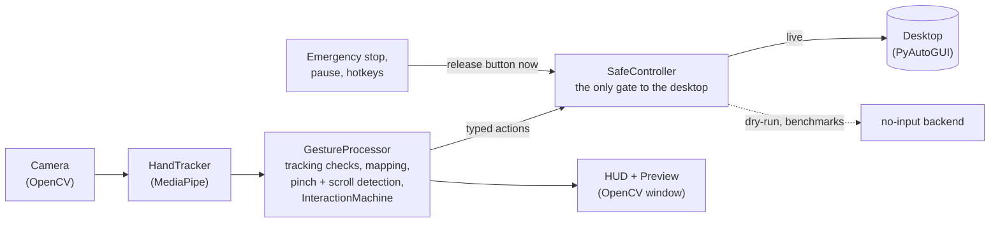

# NoCursor

**Control your Windows desktop with your hand and a webcam, no mouse required.**

NoCursor watches your hand through a normal webcam, finds 21 landmarks on it with Google's
pretrained [MediaPipe Hand Landmarker](https://ai.google.dev/edge/mediapipe/solutions/vision/hand_landmarker),
and turns simple gestures into mouse input: move the pointer with your index finger, click and
drag by pinching, scroll with two fingers. Everything runs on your own computer; video is never
recorded or sent anywhere.

It started as a computer-vision learning project with a deliberately cautious design: software
that moves a real mouse has to fail safe. So the interesting parts are not only the gestures but
how they are kept predictable: a single state machine decides what a hand means, a single gate
(`SafeController`) is the only code that can touch the desktop, the mouse button is released on
*every* way the program can stop, and there is a dry-run mode (and benchmark modes) that cannot
send input at all.

> **Status:** a working prototype validated on one Windows machine and webcam. It is not a
> production tool and makes no accessibility claims. See [Known limitations](#known-limitations).
> No license has been chosen yet (the owner's decision), so all rights are reserved for now.

## Contents

[Features](#features) · [Gestures](#gestures) · [Architecture](#architecture) ·
[Technology](#technology-stack) · [Install](#install) · [Model setup](#model-setup) ·
[Run](#run) · [Dry-run](#dry-run) · [Calibration](#calibration) · [Safety](#safety-and-the-emergency-stop) ·
[Benchmarking](#benchmarking) · [Testing](#testing) · [Limitations and troubleshooting](#known-limitations) ·
[Privacy](#privacy) · [Roadmap](#roadmap-and-contributing)

## Features

- **Pointer control** from the index fingertip, with configurable smoothing and active area.
- **Click and drag** by pinching thumb and index finger, with confirmation frames, hysteresis, a
  cooldown, and a drag threshold so hand tremor cannot start a drag.
- **Two-finger scrolling** with a dead zone, rate limit and direction option.
- **Four-corner calibration** that maps the part of the camera view *you* find comfortable onto
  the whole screen, saved locally and validated on load.
- **Pause / resume**, and an **emergency stop** that works from any window.
- **Honest live HUD**: it distinguishes a gesture *candidate* ("PINCH PENDING 3/5, not clicked
  yet") from a *confirmed* action ("PRESSED"), shows why tracking was rejected, and labels
  dry-run actions "(simulated)".
- **Dry-run mode** and **benchmarks** that physically cannot send input.
- **Measured, labelled performance**: stage timings and percentiles, with the limits of what
  they mean written next to them.
- **Quiet, bounded logging** (opt-in log file with rotation; no frames or landmark data ever).

## Gestures

| Gesture | Result |
|---|---|
| Move your **index fingertip** | Moves the pointer (it freezes while thumb and index close in, so a click lands where you aimed) |
| **Pinch** thumb and index, hold ~0.2 s, release | **Click**: the button is pressed when the pinch is confirmed and released when the pinch ends |
| Pinch, then **move your hand** more than 30 px, release at the drop point | **Drag** |
| **Index + middle** fingers up, ring + little folded, then move up / down | **Scroll** (hand up = wheel up; `--scroll-invert` flips it) |
| Hand out of view or unreliable | Nothing happens; any held button is released |

A pinch only counts after the hand has been seen open (thumb and index clearly apart). That is
required after start-up, tracking loss, calibration, pause/resume, and when scroll mode ends.
Until then the HUD says **NOT ARMED - spread thumb and index apart**.

**Pinch measurement.** The default is a **2D** ratio: the thumb-tip to index-tip distance in the
camera image divided by the wrist-to-middle-knuckle distance, activating at `0.20` for `5`
consecutive frames. A 3D variant using MediaPipe's depth estimate exists (`--pinch-depth`,
experimental) but is off by default: on real hardware the depth estimate of the two fingertips
disagreed enough to stop genuine pinches registering. The HUD, the `--diagnostics` panel, the
banner and every benchmark report state which calculation is active.

### Preview keys

| Key | Action |
|---|---|
| `Esc` / `Q` | **Stop** (always, in every mode) |
| `P` | Pause / resume (global: `Ctrl+Alt+P`) |
| `C` | Start calibration; `Space`/`Enter` captures a corner; `Backspace`/`X` cancels; `R` resets |
| `H` / `?` | Show / hide the controls help panel |

## Architecture



The gesture logic is pure (no camera, window or OS calls), so it is tested with synthetic
landmarks; the main loop takes everything it uses as a parameter, so it is tested with fakes.
Full details, the state machine diagram and the button-safety invariants:
**[docs/ARCHITECTURE.md](docs/ARCHITECTURE.md)**.

## Technology stack

| Piece | Used for | Version tested |
|---|---|---|
| Python | language | 3.12 on Windows 11 (`>=3.10` declared; only 3.12 verified) |
| [MediaPipe](https://pypi.org/project/mediapipe/) | Hand Landmarker (pretrained) | 1.1.0 |
| [OpenCV](https://pypi.org/project/opencv-contrib-python/) (`opencv-contrib-python`) | camera capture, preview window | 5.0.0.93 |
| NumPy | coordinates, smoothing | 2.5.4 |
| [PyAutoGUI](https://pypi.org/project/PyAutoGUI/) | the actual mouse input | 0.9.54 |
| pytest, Ruff | tests, lint | 9.1.1, 0.17.0 |

No model is trained; NoCursor uses the pretrained hand model and its own gesture rules.

## Install

**Prerequisites:** Windows 10/11, Python 3.10+ (3.12 tested), a webcam. The global hotkeys are
Windows-only; everything else is written to be portable but is only verified on Windows.

### Install into a clean environment

```powershell
git clone <this repository>      # or download and unzip it
cd nocursor
python -m venv .venv
.\.venv\Scripts\python -m pip install --upgrade pip
.\.venv\Scripts\python -m pip install -r requirements.txt
.\.venv\Scripts\python -m pip install -e . --no-deps
.\.venv\Scripts\python -m nocursor --download-model
.\.venv\Scripts\python -m nocursor --check
```

`pip install -e .` also installs the `nocursor` command (in `.venv\Scripts`). For an exactly
reproducible set of dependency versions use `requirements-lock.txt` (the versions the install
instructions were verified with, for Windows and CPython 3.12) instead of `requirements.txt`.

> **One OpenCV package only.** NoCursor depends on **`opencv-contrib-python`** because
> MediaPipe requires it and it includes window support. Do **not** also install `opencv-python`
> or any `-headless` OpenCV: they overwrite each other's `cv2` and a headless build cannot open
> the preview. `nocursor --check` warns if more than one is installed.

### Development install

```powershell
.\.venv\Scripts\python -m pip install -e ".[dev]"
```

## Model setup

NoCursor uses Google's pretrained `hand_landmarker.task` (about 8 MB). It is **not** stored in the
repository. Download it once:

```powershell
nocursor --download-model          # python -m nocursor --download-model also works
nocursor --redownload-model        # replace it, for example if it is corrupt
```

- **Where it goes:** `models\hand_landmarker.task` in the project folder, or in the folder you
  run NoCursor from if it was installed with a plain `pip install`. Or pass `--model PATH`.
- This is the **only** network access NoCursor ever makes, and only when you run that command.
- The download is written to a temporary file and moved into place only when complete; a failed
  or truncated download never replaces a model you already have. The file's SHA-256 is printed
  for your records (it is not enforced, because the source URL is Google's moving `latest`).
- If the network is blocked, download the file in a browser from the URL printed in the error
  and save it as `models\hand_landmarker.task`.

## Run

```powershell
nocursor --check                         # verify the installation (never opens the camera)
nocursor --dry-run --diagnostics         # try everything; nothing is sent to the desktop
nocursor --calibrate                     # one-time: mark your comfortable hand area
nocursor                                 # live control (mouse input IS sent)
```

More examples:

```powershell
nocursor --smoothing 0.7                 # steadier, slightly laggier pointer
nocursor --pinch-threshold 0.25          # easier pinch (default 0.20; lower = stricter)
nocursor --drag-start 45                 # need a bigger movement before a click becomes a drag
nocursor --scroll-invert --scroll-speed 5
nocursor --show-perf                     # rolling software timings in the preview
nocursor --log-file                      # also write logs\nocursor.log (rotating, ~4 MB max)
nocursor --print-settings                # show every effective setting, changes marked
nocursor --help                          # grouped options with defaults and valid ranges
```

Every option, its default and its valid range is in `nocursor --help`; invalid values are
rejected with a message naming the flag.

### Options reference

| Option | Default | Meaning |
|---|---|---|
| `--camera N`, `--width`, `--height` | 0, 640, 480 | Camera index and capture size |
| `--model PATH` | `models\hand_landmarker.task` | Hand-landmark model file |
| `--min-confidence` | 0.6 | Minimum hand-detection confidence (0 to 1) |
| `--smoothing` | 0.5 | Pointer smoothing, 0 to below 1 (higher = steadier but laggier) |
| `--margin` | 0.15 | Camera-edge fraction ignored by the default mapping, 0 to below 0.5 |
| `--pinch-threshold` | 0.20 | Pinch activates at or below this thumb-index ratio (lower = stricter) |
| `--pinch-confirm-frames` | 5 | Consecutive frames needed to accept a pinch (about 0.17 s at 30 fps) |
| `--pinch-release-factor` | 1.5 | A pinch ends at threshold x this (0.30 by default); must be above 1 |
| `--pinch-release-frames` | 2 | Open frames needed to confirm a release, so one glitch cannot drop a drag |
| `--click-cooldown` | 0.4 | Minimum seconds between accepted pinches |
| `--drag-start` | 30 | Screen pixels to move while pinched before a click becomes a drag |
| `--pinch-depth` / `--no-pinch-depth` | off / (the default) | Experimental 3D pinch ratio / the 2D default; giving both is an error |
| `--scroll-stable-frames`, `--scroll-dead-zone`, `--scroll-speed`, `--scroll-interval` | 6, 0.10, 8, 0.05 | Two-finger scroll tuning |
| `--scroll-invert` | off | Hand up scrolls down |
| `--calibrate`, `--no-calibration`, `--reset-calibration` | | Run / ignore / delete calibration |
| `--calibration-file PATH` | `calibration.local.json` | Where calibration is stored |
| `--dry-run` | off | Never send mouse input |
| `--stop-key`, `--pause-key` | `ctrl+alt+q`, `ctrl+alt+p` | Global hotkeys (Windows) |
| `--diagnostics` | off | Pinch internals in the preview and at DEBUG in the log |
| `--show-perf` | off | Rolling software timings in the preview |
| `--log-file [PATH]` | off | Rotating log file; bare flag means `logs\nocursor.log` |
| `-v`, `--verbose` | off | Debug logging, including routine MediaPipe start-up output |
| `--check`, `--print-settings`, `--version` | | Inspect the installation / settings / version, then exit |
| `--download-model`, `--redownload-model` | | Fetch the model (the only network access), then exit |
| `--benchmark MODE` and `--benchmark-frames`, `--benchmark-seconds`, `--benchmark-video`, `--benchmark-output` | | Dry-run benchmarks, see [Benchmarking](#benchmarking) |

### Exit codes

`0` normal / Ctrl+C, `1` startup or runtime error (camera, model, missing package), `2` stopped
by an emergency stop or the preview, `64` invalid arguments, `130` interrupted during start-up.

## Dry-run

`--dry-run` tracks your hand and shows the full HUD but **never sends mouse input**. Presses,
releases, drags and scrolls are shown and logged as simulated (`dry-run: mouse_down (simulated,
not sent)`, `would be a click`). Start here, and use it whenever you change a setting.

## Calibration

The default mapping uses the middle of the camera view. Calibration lets you choose the area:

1. `nocursor --calibrate` (or press `C` while running). **No mouse input is sent while the
   wizard is open.**
2. Place your index fingertip at the **top-left** corner of the area you want to use (as seen in
   the mirrored preview), hold still until the "hold still" bar fills, and press `Space`.
3. Repeat for **top-right**, **bottom-right**, **bottom-left**.
4. The result is validated (big enough, corners distinct and in the right order) and saved to
   `calibration.local.json` (git-ignored; it holds only the rectangle, camera index and frame
   shape). Show an open hand to resume.

`Backspace`/`X` cancels without changing anything, `R` or `--reset-calibration` removes it,
`--no-calibration` ignores it for one run. A calibration made for a different camera or frame
shape, or a corrupt file, is ignored with a message and the default mapping is used.

## Safety and the emergency stop

**Stop NoCursor at any time with any of these:**

- `Ctrl+Alt+Q` from any window (Windows; `--stop-key` to change),
- `Esc` or `Q` in the preview window, or close the window,
- `Ctrl+C` in the terminal,
- pushing the *physical* mouse into a screen corner (PyAutoGUI's fail-safe; hand tracking can
  never trigger this by accident because the pointer stays one pixel inside the screen edge).

**What NoCursor guarantees about the mouse button** (details and rationale in
[docs/ARCHITECTURE.md](docs/ARCHITECTURE.md)):

- at most one press is outstanding, and every press has exactly one release;
- the button is released on pinch release, tracking loss, pause, calibration start, emergency
  stop (immediately, even from the hotkey thread), controller error, Ctrl+C, camera failure and
  normal shutdown;
- releasing is never blocked by a stop, and it bypasses the corner fail-safe;
- after any interruption nothing resumes by itself: you must show an open hand and pinch again;
- if a release ever fails, NoCursor stops, logs an error and tells you the button may still be
  held (click the physical mouse button to clear it);
- no input is sent when tracking is lost, uncertain, or the hand is partly out of frame.

Dry-run and benchmark modes are safe *by construction*, not just by a flag: their backend
cannot send input.

## Benchmarking

```powershell
nocursor --benchmark synthetic                      # repeatable, no camera
nocursor --benchmark video --benchmark-video clip.mp4
nocursor --benchmark live --benchmark-seconds 30    # your webcam; the mouse is never touched
```

All three are dry-run and write a JSON report (to the git-ignored `benchmarks\` folder) with the
configuration, environment, method, results and caveats. They measure **software timings** inside
the NoCursor process; they are **not camera-to-display latency**. The three modes measure
different things and are never mixed. Methodology, definitions, and the results of the runs that
have actually been executed: **[docs/BENCHMARKING.md](docs/BENCHMARKING.md)**.

## Testing

```powershell
.\.venv\Scripts\python -m pytest
.\.venv\Scripts\ruff check .
```

The suite needs no webcam and sends no input. It is hermetic by design: an autouse fixture makes
outbound network connections, opening a camera, and real PyAutoGUI input raise inside tests.
Real hardware is covered by a separate manual checklist:
**[docs/MANUAL_TESTING.md](docs/MANUAL_TESTING.md)**. A plan for recording a demonstration is in
[docs/DEMO_PLAN.md](docs/DEMO_PLAN.md) (no recording exists yet).

## Known limitations

- **Verified only** on Windows 11, Python 3.12, one webcam. Treat everything else as untested.
- **Windows-only** global hotkeys (stop and pause). Elsewhere use the preview keys.
- **Primary monitor only**; one hand; the first detected hand is used.
- **Calibration is an axis-aligned rectangle**, with no perspective correction.
- **Pose thresholds are hand-proportion estimates**, not fitted to your hand: the two-finger
  scroll pose (index and middle clearly extended, ring and little clearly folded) can be hard to
  trigger or can trigger when you do not intend it. Drop accuracy depends on how your fingertip
  moves as you open your fingers.
- **The 2D pinch** can mistake a thumb passing in front of the index finger for a touch; the
  confirmation frames, hysteresis, cooldown and re-arming rules exist to absorb that.
- Scrolling into an **elevated (administrator) window** can silently do nothing: Windows blocks
  input from a non-elevated process and PyAutoGUI swallows that error on scroll.
- **Latency is not measured end to end.** See the benchmarking notes.
- A killed process or power loss cannot release a held mouse button.
- Lighting and camera quality matter; MediaPipe landmarks jitter, which is why smoothing exists.

## Troubleshooting

| Symptom | What to do |
|---|---|
| Anything unclear | `nocursor --check` first |
| `missing required package(s)` | Activate the virtual environment, then `pip install -r requirements.txt` |
| Preview window will not open / `function is not implemented` | A headless OpenCV is installed. `pip uninstall opencv-python opencv-python-headless opencv-contrib-python-headless`, then `pip install --force-reinstall opencv-contrib-python` |
| `hand_landmarker.task not found` | `nocursor --download-model` |
| Model "corrupt" / zip archive error | `nocursor --redownload-model` |
| `could not open camera N` | Another app has the camera, privacy settings block it (Windows: Settings > Privacy > Camera), or try `--camera 1` |
| Pinches do not register | `nocursor --dry-run --diagnostics` and read the `why:` line (the panel explains: not armed, ratio above threshold, scroll pose in the way, and so on) |
| Pointer cannot reach the screen edges | Run `nocursor --calibrate` |
| Pointer jitters | Raise `--smoothing` (try 0.7) and improve lighting |
| Accidental clicks | Keep `--pinch-threshold` at or below 0.20; raise `--pinch-confirm-frames` |
| Console shows MediaPipe notices | They are hidden by default; `-v` shows them. Real errors are never hidden |
| The mouse seems stuck pressed after a crash | Click the physical mouse button once |

## Privacy

- The camera is read frame by frame **in memory**; frames are processed and discarded. **No video
  or image is ever saved or transmitted**, and there is no analytics or telemetry.
- The only network access is the explicit `--download-model`.
- Local files NoCursor can create: `calibration.local.json` (a rectangle and your camera index),
  `logs/nocursor.log` (only with `--log-file`; no frames or landmark data; your home folder is
  shown as `~`), and `benchmarks/*.json` (timings, configuration and package versions; a video
  benchmark records only the clip's file name). All three are git-ignored.
- Hand landmarks are held only for the current frame.

## Roadmap and contributing

Ideas, not promises: multi-monitor and non-Windows hotkeys; a recorded-landmark replay format for
hand-present benchmarks without a video file; per-user adaptive thresholds learned during
calibration; perspective-correct calibration; more gestures once the current ones have been
validated by more people.

Contributions are welcome in the spirit of the project: safe, honest, well tested. Read
**[CONTRIBUTING.md](CONTRIBUTING.md)** and [docs/ARCHITECTURE.md](docs/ARCHITECTURE.md) first.

## Documentation index

| Document | Contents |
|---|---|
| [docs/ARCHITECTURE.md](docs/ARCHITECTURE.md) | modules, state machine, safety invariants |
| [docs/BENCHMARKING.md](docs/BENCHMARKING.md) | what is measured, how, results from executed runs |
| [docs/MANUAL_TESTING.md](docs/MANUAL_TESTING.md) | the real-hardware checklist |
| [docs/DEMO_PLAN.md](docs/DEMO_PLAN.md) | how to record a demonstration |
| [CONTRIBUTING.md](CONTRIBUTING.md) | development workflow and ground rules |
