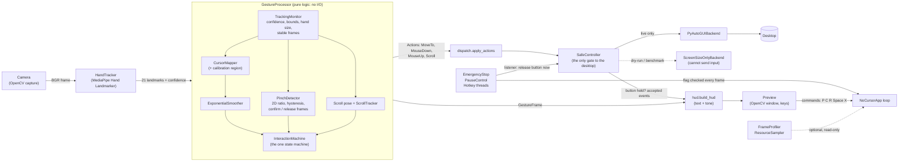
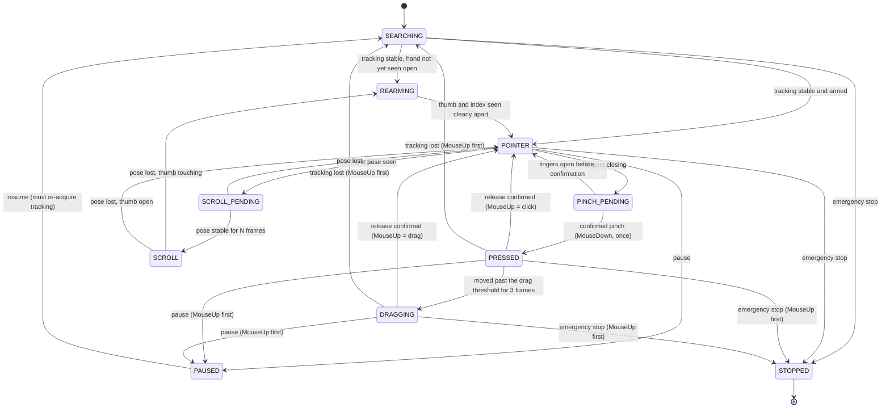

# NoCursor architecture

This document explains how NoCursor is put together, the state machine that decides what a hand
gesture means, and the invariants that keep the mouse button from ever being left stuck down.
The diagrams are [Mermaid](https://mermaid.js.org/), which GitHub renders; they are plain text,
so they are easy to keep in sync with the code.

## Design goals

1. **Safety first.** Nothing can reach the desktop except through one gate (`SafeController`).
2. **Pure logic in the middle.** Gesture interpretation never touches OpenCV windows, the
   camera, or the operating system, so it is tested with synthetic landmarks.
3. **Everything injectable.** The main loop receives its camera, tracker, preview, controller
   and clock, so tests run it with fakes (and the test suite is *forbidden* from using the real
   network, camera or mouse; see `tests/conftest.py`).
4. **Local only.** Frames are processed in memory and never written or sent anywhere.

## Module flow



The loop in `app.py` is the only place these parts meet. Per frame it: reads a frame, runs
inference, asks `GestureProcessor` what the hand means, applies the resulting actions through
`SafeController`, then draws the preview.

## Modules

| Module | Responsibility |
|---|---|
| `camera` | OpenCV capture; tolerates dropped frames, raises `CameraError` when the camera dies |
| `hand_tracker` | MediaPipe wrapper; captures native start-up output so errors are not hidden and noise is |
| `models`, `tracking` | `HandObservation`; decides whether a frame is trustworthy enough to act on |
| `mapping`, `smoothing`, `calibration` | Camera to screen coordinates; the four-corner wizard and its versioned store |
| `gestures`, `scroll` | Pinch detection (hysteresis, confirmation, cooldown); scroll pose and wheel conversion |
| `interaction` | `InteractionMachine`: states, actions, priorities |
| `processor` | Wires the above into `process(observation) -> GestureFrame` |
| `controller` | `SafeController`: single-press invariant, dry-run, stop/inhibit gating, release-on-stop |
| `dispatch` | Turns actions into controller calls and reports which events were really accepted |
| `emergency` | Emergency stop latch with listeners, pause flag, global hotkey threads (Windows) |
| `hud`, `preview` | What the screen says (pure, tested) and how it is drawn (OpenCV) |
| `metrics`, `profiling`, `resources` | Percentiles, per-stage timing, CPU / memory sampling |
| `benchmark`, `synthetic` | Synthetic / video / live benchmarks; always dry-run |
| `logging_setup` | Console and optional rotating file logging, redaction, native-output capture |
| `runtime`, `cli`, `checks`, `settings`, `model_setup`, `environment`, `paths` | Assembly and the command line |

## Interaction state machine

`InteractionMachine` is the single authority on what a gesture means. It consumes one input per
frame and returns the desktop actions to perform; it never touches the desktop itself.



The diagram shows the main paths; the rule that tracking loss, pause and stop apply from *every*
state is implemented once, at the top of `InteractionMachine.step`.

| State | Meaning | Pointer |
|---|---|---|
| `SEARCHING` | Tracking not reliable (lost, uncertain or still locking on) | no input |
| `REARMING` | Tracking fine, but an open hand must be seen before a pinch counts | frozen |
| `POINTER` | Armed and pointing | follows the fingertip |
| `PINCH_PENDING` | Fingers closing / confirming (or a pinch refused by the cooldown) | frozen |
| `PRESSED` | Button down, no drag yet | frozen |
| `DRAGGING` | Button down, pointer tracks the fingertip | follows |
| `SCROLL_PENDING`, `SCROLL` | Two-finger pose seen / scrolling | not moved |
| `PAUSED`, `STOPPED` | No input (`STOPPED` is terminal) | no input |

### Priorities (highest first)

1. `STOPPED` and `PAUSED`.
2. Unreliable tracking: `SEARCHING`. A held button is released.
3. A held pinch (`PRESSED` / `DRAGGING`) continues until the pinch is confirmed released. Nothing,
   including a scroll pose, can preempt it.
4. A stable scroll pose (only recognised when thumb and index are apart and no button is held).
5. A confirmed pinch-down starts `PRESSED`.
6. Pointing.

Anything ambiguous (half-curled fingers, low confidence, a partly visible hand) falls to the
safest outcome: no scroll, no press.

### Pinch measurement

The pinch ratio is the thumb-tip to index-tip distance divided by the wrist-to-middle-knuckle
distance, **measured in the image plane (2D)**. This is the default because MediaPipe's depth
estimate disagreed between the two fingertips enough to stop pinches registering on real hardware.
The 3D ratio remains available as `--pinch-depth` (experimental).

| Rule | Default |
|---|---|
| Activation | ratio at or below `0.20` |
| Confirmation | `5` consecutive frames |
| Release level (hysteresis) | ratio at or above `0.20 x 1.5 = 0.30`, for `2` consecutive frames |
| Cooldown | `0.4 s` between accepted pinches |
| Re-arming | after start-up, tracking loss, pause, calibration or scroll mode, an open hand (ratio at least `0.30`) must be seen first |
| Drag | fingertip moves more than `30` screen pixels from the press point for `3` frames |

## Mouse-button safety invariants

These hold at two independent layers: the state machine and `SafeController`.

1. **At most one press is outstanding.** A second `mouse_down` while one is held is refused.
2. **Every successful press has exactly one release.** A `mouse_up` with nothing held is ignored,
   so repeated frames can never repeat a release.
3. **Releasing is never blocked.** The emergency stop, pause and calibration inhibit *new* actions
   but not the release of a held button. A release also bypasses PyAutoGUI's corner fail-safe,
   which would otherwise raise instead of releasing.
4. **The emergency stop releases immediately.** `SafeController` registers a stop listener, so the
   release is attempted on whichever thread triggers the stop (the hotkey thread included), not
   only when the video loop next runs.
5. **Every exit path releases.** Pinch release, tracking loss, pause, calibration start,
   emergency stop, controller error, Ctrl+C, camera failure and normal shutdown all end with the
   button up. Shutdown releases the button *first*, before closing the camera.
6. **An interrupted interaction is never resumed.** After tracking loss, pause or reset the
   detector is disarmed; a new press needs an open hand and a fresh confirmation.
7. **A failed release is loud.** The controller records what happened, trips the stop, logs an
   error and tells you the button may still be held (`fault_message`, shown in the preview and
   printed on exit).
8. **State is cross-checked every frame.** If the controller holds a button the state machine does
   not know about, it is released before the frame's actions run.
9. **The UI never claims an action that did not happen.** `PRESSED` is displayed only when the
   controller holds the button; "Button pressed" toasts appear only for events the controller
   accepted; in dry-run both are labelled `(simulated)`.

Dry-run and benchmarks are enforced by construction as well as by a flag: their controller's
backend (`ScreenSizeOnlyBackend`) can report a screen size and nothing else, and every input
method raises.

## Threads

The main loop is single-threaded. Background threads only (a) poll the global hotkeys
(`HotkeyWatcher` for the stop, `HotkeyAction` for pause) and (b) nothing else. Shared state is
tiny: the stop latch, the pause flag, and the controller (guarded by a re-entrant lock).

## Coordinates and calibration

- MediaPipe landmarks are normalised to the *unmirrored* camera image. The preview is mirrored.
- `CursorMapper` flips x so moving your hand right moves the pointer right.
- Calibration stores one axis-aligned rectangle in **mirrored preview coordinates**
  (`calibration.local.json`, versioned, validated, git-ignored). Fingertips outside it clamp to
  the screen edge, and the pointer stays one pixel inside the screen so hand tracking can never
  trigger PyAutoGUI's corner fail-safe.

## Timing and performance

Stage timings use `time.perf_counter_ns` inside the process. The boundaries are fixed:

```
camera.read() ... [frame arrives] ---- inference ---- gesture ---- dispatch ---- (end-to-end) ---- preview
 frame_wait                            inference      gesture      dispatch                          preview
```

`end_to_end` runs from frame arrival to the end of dispatch: software processing latency. It
excludes camera exposure and transfer, the display, and operating-system input handling, so it is
**not** camera-to-display latency. See [BENCHMARKING.md](BENCHMARKING.md).

## Privacy

Frames live only in memory for the duration of one loop iteration. Nothing is recorded, saved or
transmitted. The only network access is the opt-in model download. Logs never contain frames or
landmark arrays, and the log formatter replaces your home directory with `~`.

## Testing strategy

- Gesture logic: synthetic landmarks through the real processor and state machine.
- The loop: fake camera, tracker, preview, clock and backend (`tests/test_app*.py`).
- Safety: stop, loss, pause and failure paths at both layers, plus mutation checks run during
  development (deliberately breaking the code and confirming a test fails).
- Real-world isolation: an autouse fixture makes outbound network access, `cv2.VideoCapture` and
  real PyAutoGUI input raise during tests.
- Real hardware is covered by the manual checklist, [MANUAL_TESTING.md](MANUAL_TESTING.md).
